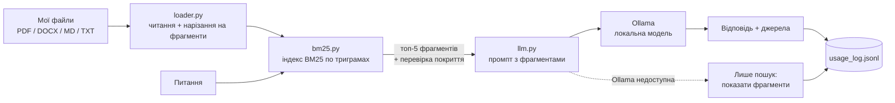
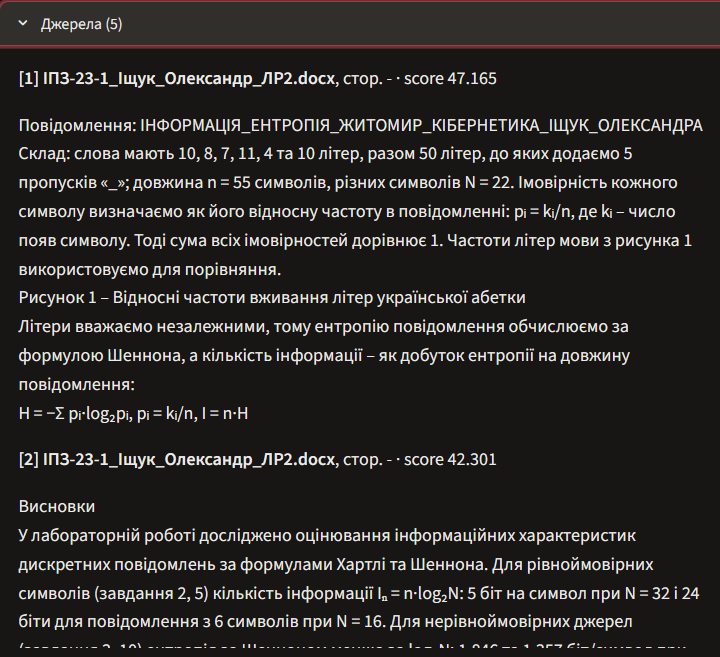
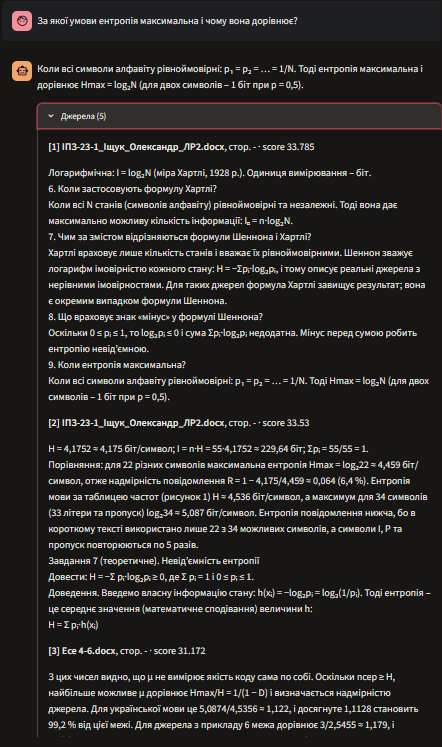
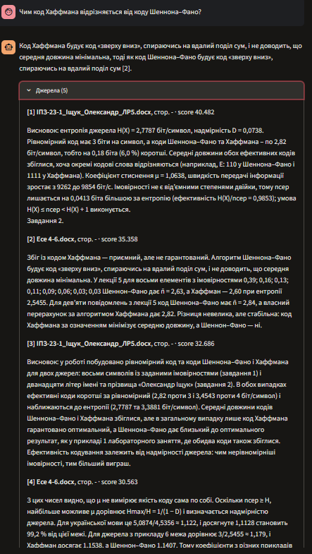
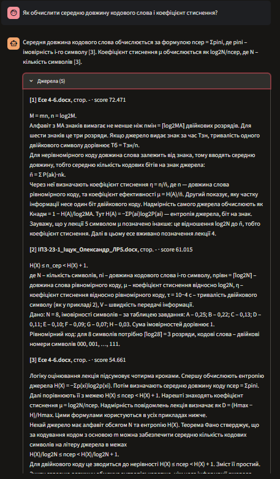
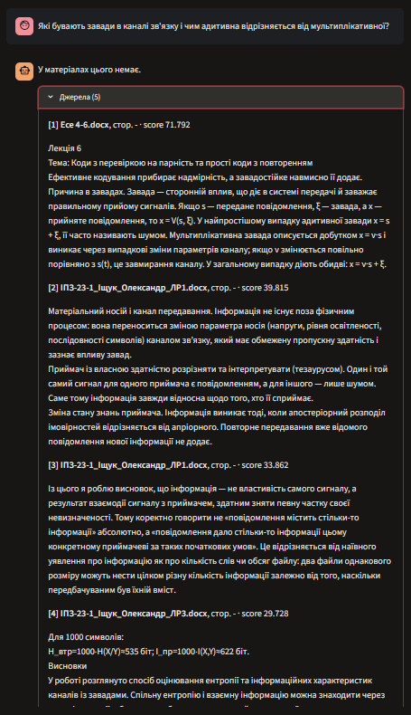
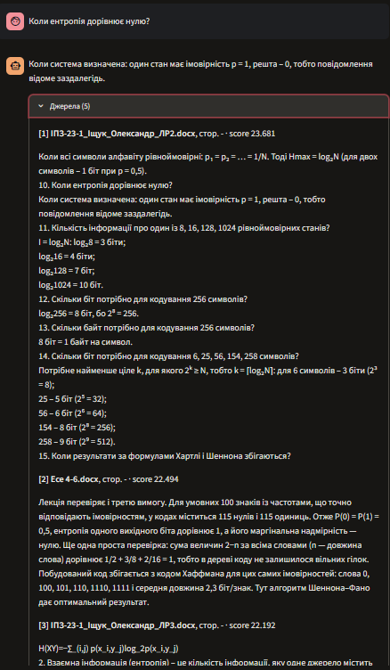
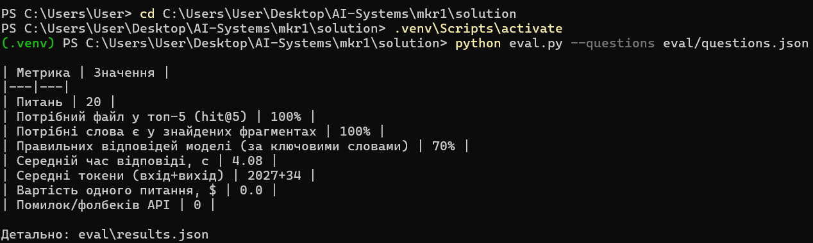
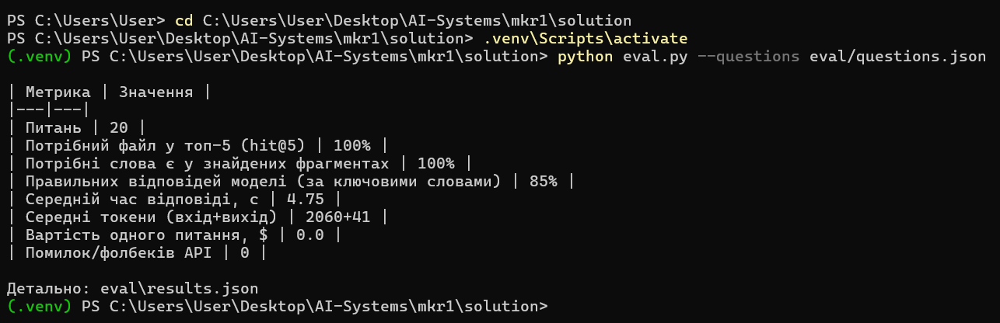
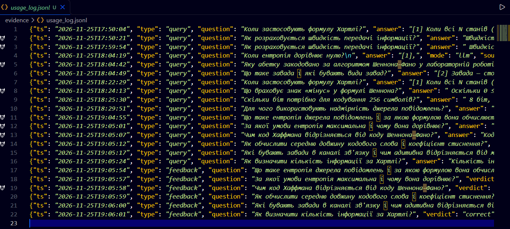

# МКР №1. Як я покращив своє життя за допомогою AI

**Тема:** RAG-помічник, який відповідає на питання по моїх навчальних матеріалах і вказує джерело (файл і фрагмент; для PDF ще й сторінку).

---

## 0. План рішення

| Поле | Що написано |
|---|---|
| **Проблема** | Готуючись до занять і іспитів, я постійно шукаю відповіді у власних матеріалах: конспекти, слайди, PDF підручників (предмет: **«Теорія інформації та кодування»**, 9 файлів DOCX: лабораторні роботи 1–6, розрахункова робота, лекційні есе; після розбиття на фрагменти це 157 шматків). Це повторюється приблизно 15–20 разів на тиждень, особливо перед модульними й екзаменами. |
| **Поточний процес** | Згадати, у якому файлі це було → відкрити → Ctrl+F за ключовим словом → перечитати знайдені місця → якщо не знайшов, відкрити наступний файл. У середньому приблизно 1 хв 47 с на одне питання (це моя оцінка за власним досвідом, окремо не заміряно). |
| **Дані** | Мої власні файли `.pdf`, `.docx`, `.md`, `.txt` у папці `solution/docs/`. Вхід — питання українською, вихід — відповідь із посиланнями на фрагменти. |
| **Рівень рішення** | **Рівень 2 — RAG.** Моделі потрібні дані, яких немає «в її голові»: мої конспекти й слайди. Одного промпту недостатньо, бо матеріали не вміщуються в нього цілком. Агент (рівень 3) не потрібен: сценарій завжди однаковий — знайти фрагменти й відповісти. Fine-tuning (4) і власна модель (5) не потрібні: матеріали змінюються, а RAG не вимагає перенавчання. |
| **Метрика успіху + ціль** | 1) **Час на одне питання:** за моєю оцінкою було 1 хв 47 с, ціль — **не більше половини** від початкового. 2) **Потрібний файл у топ-5 пошуку (hit@5):** ціль ≥ 90%. 3) **Правильних відповідей на 20 тестових питаннях:** ціль ≥ 80%. |
| **Ризики / fallback** | Модель може помилитися або вигадати. Тому кожна відповідь має посилання на фрагменти, я звіряю їх з джерелом. Якщо Ollama не запущена, програма переходить у режим «лише пошук» і показує знайдені фрагменти. Повна таблиця ризиків — у п. 5. |

---

## 1. Архітектура рішення



Компоненти:

- **Завантаження й нарізання** (`rag/loader.py`): PDF читається посторінково (`pypdf`), DOCX через `python-docx`, MD ділиться за заголовками. Фрагменти ~900 символів із перекриттям, щоб думка не обривалась на межі.
- **Пошук** (`rag/bm25.py`): BM25 по символьних триграмах слів. Це стійко до відмінків української мови («база», «бази», «базами»). Фрагмент проходить, лише якщо містить достатню частку термінів питання (`MIN_COVERAGE`), так відсікаються питання не по темі.
- **Генерація** (`rag/llm.py`): фрагменти передаються моделі з інструкцією відповідати тільки за ними, ставити номери джерел і чесно казати «у матеріалах цього немає».
- **Сценарій і журнал** (`rag/pipeline.py`): повертає відповідь, джерела, час, токени, вартість; пише кожен запит у `evidence/usage_log.jsonl`.
- **Інтерфейси:** веб-чат (`app.py`, Streamlit) і командний рядок (`ask.py`). Окремий `eval.py` міряє якість на наборі питань.

## 2. Використані AI-технології та інструменти

| Що | Навіщо |
|---|---|
| **Ollama** + модель **gemma3:4b** | локальна генерація відповідей; безкоштовно, дані не залишають комп'ютер |
| **BM25** (власна реалізація, Python) | пошук релевантних фрагментів без ембедингів і векторної бази |
| `pypdf`, `python-docx` | читання PDF і DOCX |
| **Streamlit** | веб-інтерфейс чату |
| Claude (необов'язковий режим `LLM_PROVIDER=claude`) | запасний варіант генерації через API; у роботі не використовувався, лише передбачений як запасний варіант |

## 3. Обґрунтування вибору підходу

Я пройшов запитання з п. 3 завдання:

1. *Чи вистачає одного промпту?* Ні: матеріали (9 файлів, 157 фрагментів) не вміщуються в один запит, і потрібні тільки релевантні уривки.
2. *Чи потрібні дані, яких немає в моделі?* Так, це мої конспекти й слайди, значить **рівень 2 (RAG)**.
3. *Чи потрібні послідовні кроки з рішеннями між ними?* Ні. Сценарій завжди однаковий: знайти → відповісти. Тому агент був би зайвим ускладненням.
4. *Fine-tuning?* Ні: немає десятків прикладів, на яких RAG системно програє, а матеріали регулярно оновлюються.

**Чому BM25, а не векторний пошук.** Для невеликого корпусу власних конспектів BM25 по триграмах дає хороший результат без додаткових моделей, залежностей і витрат. Недолік: не знаходить синонімів без спільних коренів (див. п. 8). Якби результат пошуку виявився недостатнім, наступним кроком були б ембединги.

**Чому локальна Ollama.** Рішення безкоштовне, працює без інтернету й не передає мої матеріали стороннім сервісам. Ціна — менша якість малих моделей порівняно з хмарними.

## 4. Реалізація

Код — у `solution/`, інструкція запуску — у `solution/README.md`. Коротко:

```bash
ollama pull gemma3:4b
cd solution && pip install -r requirements.txt
python index.py && streamlit run app.py
```

## 5. Ризики та обмеження

| Ризик | Ймовірність / критичність | Що робити |
|---|---|---|
| Модель дає неправильну або вигадану відповідь | Середня ймовірність (особливо у малих моделей); наслідок неочевидний одразу | Система промпту вимагає відповідати лише за фрагментами; у відповіді є номери джерел; я звіряю з показаним файлом і сторінкою; кнопка 👎 фіксує помилки в журналі |
| Ollama не запущена або модель не завантажена | Середня; некритично | Автоматичний fallback у режим «лише пошук»; повідомлення, що саме зробити (`ollama pull …`) |
| Матеріали відрізняються від тестових: скановані PDF без тексту, фото конспектів | Висока для сканів; критично для цих файлів | Такі файли не індексуються. Для них потрібен OCR (не реалізовано); у README це вказано як обмеження |
| Шуканий термін записаний синонімом, якого немає в документі | Середня; відповідь «не знайдено» | Переформулювати питання; в майбутньому додати ембединги |
| Вікно контексту переповнене, Ollama мовчки обрізає промпт | Низька при `OLLAMA_NUM_CTX=8192` | Програма виводить попередження, якщо промпт заповнив вікно; можна зменшити `TOP_K` |
| Слабкий комп'ютер: відповідь займає багато часу | Не виникав: середній час відповіді 4,75 с (замір `eval.py` на 20 питаннях) | Менша модель (`llama3.2:3b`) або режим «лише пошук» |
| Питання не по темі: пошук знаходить випадкові збіги | Низька після введення `MIN_COVERAGE` | Поріг покриття; тест у `tests/` перевіряє це |
| Оновлені файли не потрапили в індекс | Середня; відповідь за старою версією | Кнопка «Переіндексувати» / `python index.py` |
| Час ручного пошуку («до») не заміряно, лише оцінено | Висока; впливає на точність порівняння | У звіті «до» чітко позначено як оцінку; надійні лише значення «після» (`eval.py` і журнал) |
| Мала модель плутає схожі числа в одному фрагменті (замість середньої довжини коду 4,5785 назвала ентропію 4,5364) або відповідає самими номерами джерел | Середня; помилка непомітна без звірки | Звіряти числа й формули з показаним фрагментом; у v2 додано повторний запит із нагадуванням і запасну відповідь, якщо модель повертає лише номери |

## 6. Використання в реальному житті

Рішення використовувалось з 25.11.2026 для підготовки до модульного контролю (дедлайн здачі — 01.12.2026). Станом на 25.11.2026 у журналі зафіксовано 17 реальних запитів і 9 оцінок (6 × 👍, 3 × 👎).

Докази — у папці `evidence/`:

- `usage_log.jsonl`: журнал усіх запитів, створений автоматично;
- `eval_results_v1.json` і `eval_results_v2.json`: результати `eval.py` на 20 питаннях до і після виправлення промпту;
- `screenshot_eval.png`, `screenshot_eval_v2.png`: таблиці результатів `eval.py`;
- `screenshot_usage_log.png`: журнал із запитами та оцінками 👍/👎;
- скриншоти чату з реальними питаннями: 

Скриншоти чату з реальними питаннями (блок «Джерела» розкрито):








Результати `eval.py`:




Журнал використання:




## 7. Результат «до / після»

**Про заміри.** Окремого заміру ручного пошуку я не проводив, тому значення «до» — це моя приблизна оцінка за власним досвідом (позначена «оцінка»). Значення «після» виміряні: `python eval.py` на 20 питаннях і журнал використання `evidence/usage_log.jsonl`. Через це порівняння «до/після» орієнтовне, а не точне.

| Показник | До AI | Після AI |
|---|---|---|
| Час на одне питання (середній) | ≈ 107 с, тобто 1 хв 47 с (оцінка) | 4,75 с (замір `eval.py`, 20 питань) |
| Ручні операції на питання (відкрити файл, Ctrl+F, перечитати, перейти в інший файл) | ≈ 3 (оцінка) | 1 (ввести питання) |
| Правильних відповідей з першої спроби | не вимірювалось | 17 з 20 за автоматичною перевіркою (85%); 19 з 20 після ручної звірки з документами |
| Потрібний файл у топ-5 (hit@5) | — | 100% (20 з 20) |
| Економія часу | — | приблизно 96% (оцінка «до» проти виміряного «після») |
| Вартість одного прогону | 0 | $0 (локальна модель Ollama; електроенергію не враховую) |

**Дві ітерації якості** (той самий набір із 20 питань, `evidence/eval_results_v1.json` і `eval_results_v2.json`):

| Версія | Правильно (автоматично) | Середній час | Токени (вхід + вихід) | Вартість |
|---|---|---|---|---|
| v1 (перший промпт) | 14 з 20 (70%) | 4,08 с | 2027 + 34 | $0 |
| v2 (промпт + повторний запит + запасна відповідь) | 17 з 20 (85%) | 4,75 с | 2060 + 41 | $0 |

Після ручної звірки з документами у v2 правильні 19 з 20 відповідей. Дві «невдачі» автоматичної перевірки виявились надто суворими ключовими словами, одна відповідь хибна (середня довжина коду Шеннона–Фано).

**Економіка.** Ollama працює локально, тому прогін коштує $0. Для порівняння: якби використовувати Claude Haiku 5.5 через API, один прогін (у середньому 2060 вхідних і 41 вихідний токен) коштував би близько $0,0002, тобто частки цента, але у цьому рішенні платної моделі немає.

## 8. Аналіз результату (відповіді на питання)

**1. Яку проблему ви вирішували?**
Повільний ручний пошук відповідей у власних навчальних матеріалах (конспекти, слайди, PDF).

**2. Чому ця проблема є для вас реальною та корисною для автоматизації?**
Я шукаю відповіді постійно, а перед іспитами щодня. Задача повторювана, однотипна й вимагає перегляду багатьох файлів. Зараз я шукаю відповіді в конспектах приблизно 15–20 разів на тиждень, і кожен пошук забирає близько 1 хв 47 с.

**3. Як задача виконувалась до використання AI?**
Вручну: згадати файл, відкрити, пошук за ключовим словом, перечитування, перехід до наступного файлу. Приблизно 107 с (1 хв 47 с) на питання (оцінка за власним досвідом, не заміряно).

**4. Яке AI-рішення ви побудували?**
Локальний RAG-помічник: пошук BM25 по моїх файлах + відповідь моделі Ollama із посиланнями на джерела, веб-чат, журнал використання та скрипт вимірювання якості.

**5. Чому ви обрали саме цей рівень AI-рішення?**
Рівень 2 (RAG), бо моделі потрібні мої приватні матеріали, яких вона не знає. Рівні 3–5 були б надмірними (див. п. 3).

**6. Які альтернативи ви розглядали?**
(а) Просто вставляти матеріали в чат: не вміщуються, незручно повторювати. (б) Векторний пошук з ембедингами: складніше й повільніше, а для невеликого корпусу BM25 вистачило. (в) Хмарна модель (Claude API): краща якість, але платно, і матеріали йдуть у сервіс. Залишив її як необов'язковий режим. (г) Агент: не потрібен для сценарію з одного кроку.

**7. Які AI-моделі та інструменти використали?**
Ollama з моделлю gemma3:4b, BM25 (власна реалізація), pypdf, python-docx, Streamlit. Див. п. 2.

**8. Які проблеми або помилки виникли?**
Під час розробки: (1) питання не по темі випадково збігалися з документами через спільні триграми, тому я додав поріг покриття термінів і тест на це; (2) за замовчуванням Ollama використовує мале вікно контексту й може мовчки обрізати промпт, тому я явно задаю `num_ctx` і виводжу попередження. (3) у першій версії (v1) модель у 4 з 20 тестових питань відповідала лише номерами джерел, наприклад `[2]`; я змінив промпт і додав повторний запит та запасну відповідь, після чого автоматична оцінка зросла з 70% до 85%; (4) помилка лишилась у питанні про середню довжину коду Шеннона–Фано: у висновку лабораторної роботи поруч стоять ентропія 4,5364 і середня довжина 4,5785, і модель двічі назвала перше число замість другого; (5) пошук BM25 не знаходить синонімів без спільного кореня.

**9. Наскільки надійним є ваше рішення?**
За вимірюванням на 20 питаннях: потрібний файл знайдено у 100% випадків (hit@5), правильних відповідей — 85% за автоматичною перевіркою і 19 з 20 (95%) після ручної звірки з документами (дві з трьох «невдач» автоматичної перевірки виявились надто суворими ключовими словами, одна — реальною помилкою; ключові слова я після перегляду результатів не змінював); оцінки 👍/👎 з журналу на 25.11.2026: 6 × 👍 і 3 × 👎. Відповідям довіряю лише з перевіркою джерела: рішення скорочує пошук, але не замінює читання матеріалу. Особливо це стосується малих моделей.

**10. Що змінилося після впровадження AI?**
Замість пошуку по файлах я ставлю питання й одразу бачу відповідь із місцем у документі. Мені більше не треба згадувати, у якій лабораторній чи лекції це було. Формули й таблиці з DOCX теж знаходяться. Відповідь я завжди звіряю з показаним фрагментом, бо мала модель інколи помиляється, тому використовую помічник як швидкий вказівник на потрібне місце в матеріалах, а не як заміну читання.

**11. Скільки часу або інших ресурсів вдалося заощадити?**
За моєю оцінкою, середній час на питання скоротився з приблизно 107 с до 4,75 с (близько 96%; значення «до» оцінене, а не заміряне, тому це орієнтовна цифра). За 17 запитів у журналі на 25.11.2026 це приблизно 29 хвилин. Час «після» (4,75 с) враховує лише генерацію відповіді, без набору питання й звірки джерела, тому реальна економія трохи менша. Грошових витрат немає.

**12. Що ви змінили б у своєму рішенні, якби продовжували його розвивати?**
Додав би ембединги для пошуку синонімів, OCR для сканованих PDF, показ точного уривка в PDF (підсвітку), оцінку відповіді другим прогоном моделі та порівняння кількох моделей Ollama на моєму наборі питань.
